<picture>
  <source media="(prefers-color-scheme: dark)" srcset="./dark.svg">
  <source media="(prefers-color-scheme: light)" srcset="./light.svg">
  
</picture>

# Hello

I build practical AI experiences, full-stack product interfaces, and reliable engineering systems that turn ideas into working software.

## Focus

- AI / ML
- Full-stack product engineering
- API design and backend systems
- Product workflows and intelligent tooling
- Data-driven applications and experimentation

## Featured projects

- [AI-Interview-Road-map-Analysis](https://github.com/Nasrullah4222/AI-Interview-Road-map-Analysis) — AI-powered interview analysis and career preparation workflows.
- [FlowerClassification](https://github.com/Nasrullah4222/FlowerClassification) — image classification experiments and model exploration.
- [Banking-System](https://github.com/Nasrullah4222/Banking-System) — backend-focused banking system and application flow.
- [my-portfolio-412](https://github.com/Nasrullah4222/my-portfolio-412) — portfolio and product showcase.
- [Endoscopy-Contamination-Segmentation-Models](https://github.com/Nasrullah4222/Endoscopy-Contamination-Segmentation-Models) — medical imaging and segmentation research workflows.

## Engineering stack

JavaScript, React, Node.js, Express, Python, Jupyter, ML pipelines, REST APIs, GitHub workflows, frontend engineering, backend systems.

## About

I enjoy building systems that connect technical depth with real user value — from AI-assisted experiences to web applications and platform thinking. The work blends product development, data experimentation, and practical engineering.

## Connect

- [GitHub](https://github.com/Nasrullah4222)
- [Portfolio](https://my-portfolio-412.vercel.app)

## Current direction

- AI product development
- Full-stack engineering
- Practical ML and decision-support systems
- Clean product experiences and maintainable architecture
